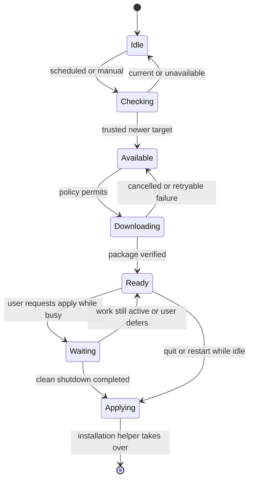

# Automatic updates

Status: design, November 6, 2026. Kielbox does not currently check for or install
updates. The Windows workflow produces unsigned ZIP snapshots. This document
specifies the installed-app updater; it does not enable a feed or publish files.

## Decision

Use **Velopack** for installation and applying updates, with a Kielbox controller
for scheduling, user interaction, and shutdown. Its official Rust SDK supports
Windows, macOS, and Linux. Pin the SDK and `vpk` packaging tool to compatible,
reviewed versions when implementation starts. See the
[Rust integration guide](https://docs.velopack.io/getting-started/rust) and
[version guidance](https://docs.velopack.io/troubleshooting/faq).

Use **TUF metadata verification** before handing a release to the installer.
Select and test a maintained Rust TUF client during the first implementation
step. Keep signature verification, metadata expiry, rollback protection, and key
rotation in that library rather than inventing a signed-JSON protocol. TUF
authenticates downloaded targets; Velopack applies the verified package. These
are separate responsibilities. [TUF overview](https://theupdateframework.io/docs/overview/)

Windows x64 is the first target. macOS/Linux adapters follow when those desktop
builds exist. Platform package managers should own updates for their packages;
Kielbox must not overwrite a Homebrew, distro, or store-managed installation.

## What the user sees

Settings gains an **Updates** section with the installed version, channel, last
check, **Check now**, and two options: **Download updates automatically** and
**Install downloaded updates when I quit**. Both can default on for a supported
installed build once the release pipeline is qualified. Preview is opt-in;
normal builds follow Stable. No forced deadline or blocking startup dialog.

Check in the background 30 seconds after startup, then at most once per 24 hours
with jitter. A manual check bypasses the interval. Keep one request/download in
flight; cancel it during shutdown. Back off after failures. Offline checks leave
the app usable and produce a quiet status message, not repeated notifications.

Downloading normally waits until capture and media work are idle. Show a small
**Update ready — Restart** notice after verification. A manual restart request
while busy explains the active work and offers **Later** or **Stop capture and
restart**. The latter explicitly requests normal capture shutdown. It must not
kill recording or silently turn off replay.

Ordinary Quit may install an already verified update after clean shutdown, but
must leave the app closed. Only **Restart** relaunches it. Closing the window to
the tray is not Quit. During OS shutdown, skip any update that cannot complete
the normal idle/shutdown gate promptly; never delay finalizing user media to
install it.

## Shutdown gate

The UI's recording indicator alone is insufficient. The controller needs a
shared activity snapshot and an exclusive shutdown barrier covering:

- Native recording, replay, queued replay saves, and finalization workers.
- Quick screencasts, paused recordings, and pending picker/countdown starts.
- Exports, microphone processing, screenshot saves, and configured upload work.
- Project autosaves, preferences writes, and recovery journal flushes.
- Disk scans, cleanup operations, and other workers that need cancellation/join.

For ordinary install-on-quit, wait for the existing clean Quit path to finish.
For explicit restart, stop admitting new work under the same barrier, request
graceful stop/cancellation through existing owners, then await actual worker
retirement and durable saves. Recheck the gate under that barrier before
handoff. A failure leaves the old app running with the update ready for retry.
Never use a fixed sleep, force-kill media workers, or restart a still-live owner.

Add a per-user instance/update lock before enabling installation. The barrier
must cover every Kielbox instance using the managed install, including elevated
instances. If another instance cannot participate, defer. The updater must not
request elevation to force it closed. The first release should use one tray
owner and forward later launches to that instance.

## Application files and user data

Velopack replaces application binaries during an update, so settings must live
outside its managed directory. That is also its
[documented preservation model](https://docs.velopack.io/integrating/preserved-files).

Keep three distinct locations:

| Location | Owner and contents |
| --- | --- |
| Velopack-managed installation | Application, cleanup helper, assets, notices; immutable to the running app. |
| `%LOCALAPPDATA%\KielboxData\` | Bootstrap configuration, updater state, trusted metadata, bounded download cache; outside the managed install. |
| Existing chosen working folder | `projects/`, default recordings/exports, toolkit settings, and their existing recovery files. Capture destinations selected elsewhere remain there. |

Implement a central working-folder resolver **before** the first updatable
installer. Today relative paths use the process working directory. An updater
restart must not silently change that directory or create a new empty library.

For an existing installation, the user confirms its current absolute working
folder once. Store that selection atomically in the bootstrap configuration.
For a new installation, offer a data-folder choice. Do not infer a migration from
where an executable happens to sit, move captures, merge folders, or replace an
existing preference file. Keep the existing RCR format and keyring identifiers.

Add an explicit `--working-directory` launch option distinct from the doctor's
existing `--data-folder` capture-folder check. After Velopack's required early
startup hooks, resolve the data folder before any preference, project, log, or
capture path is initialized. Installer shortcuts and restart handoff use the
same bootstrap resolver. Preserve arguments as structured values; never build
a shell command from paths.

Legacy ZIPs and source builds remain manual-update installations. Offer a link
to the installer, with the existing data-folder choice preserved. Do not enable
Velopack APIs against an arbitrary ZIP or silently convert its directory into a
managed install. Updatable portable packaging can follow as a separate tested
installation mode.

## Feed, versions, and trust

Keep the private repository private. Existing authenticated Actions artifacts
remain manual downloads while the update service is absent. Do not put a GitHub
PAT in the app, ask users for a maintainer credential, or treat expiring Actions
artifact URLs as permanent releases.

Before enabling automated checks, choose a dedicated HTTPS feed with an explicit
distribution audience. A possible future address is
`https://updates.kieler.dev/kielbox/`; it is a proposal, not a configured service.
Public binary hosting requires an explicit publication decision even when the
source remains private. A private feed needs per-user authentication designed
separately. Until one of those routes is ready, keep checking disabled.

Use SemVer for the application and packages: `0.2.0` for Stable and
`0.3.0-beta.1` for Preview. CI labels such as `ci-123-<commit>` identify snapshots
and are not update versions. A release tag must match the Cargo version. Keep
Stable and Preview catalogs separate; changing to Stable must never silently
downgrade an installed preview.

The client embeds a bootstrap TUF root. Persist trusted metadata versions and
verify expiry, signatures, platform/channel, target length and digest before
parsing the release catalog or staging a package. Keep the root signing key
offline, isolate online signing roles in the release environment, and use TUF's
rotation procedure. Losing trust disables updates rather than falling back to
an unsigned catalog. Bound metadata sizes, package sizes, redirect destinations,
download duration, disk reservations, and extracted contents. Never execute
commands or render active HTML from release notes.

The Velopack source adapter must read the already authenticated catalog and
verified local target files. It must not fetch an unverified catalog or a
different package in the background after Kielbox has verified one. Proving
this handoff, including delta reconstruction, is an implementation gate. Start
with full packages; add deltas only after end-to-end integrity tests.

Authenticode is a separate Windows distribution decision. Sign the application,
installer, and updater together when a signing identity is provisioned. A
package SHA256 in the current manifest detects corruption but does not establish
publisher identity. Neither a passing build nor a GitHub tag supplies update
signing. [Velopack signing](https://docs.velopack.io/packaging/signing)

## Installation and failure recovery

Let Velopack own file replacement and its installation layout. Do not write
over the running executable or run an in-place ZIP extraction. Keep the previous
installer and target package until the new build has reached a healthy startup:
preferences loaded, the expected data root opened, and the main window/tray
ready. Hardware capture or an FFmpeg installation is not a startup requirement.

The implementation spike must demonstrate that a failed apply leaves a runnable
installation. Automatic rollback after a successful install followed by an app
crash is **not assumed**. First ship a documented repair/reinstall path using the
retained installer and an unchanged data root. Add supervised rollback only
after the chosen framework's behavior has been proved for Kielbox. Do not
advertise silent rollback before that exists.

Keep updater state and launch-failure counters separate from preferences.
Bound retries to avoid crash loops. Back up settings before a schema migration;
initial updatable releases should keep data backwards compatible so a previous
installer can still open it. Never roll back or delete recordings and projects.

## Build and release pipeline

The current [Windows workflow](WINDOWS_BUILDS.md) builds, tests, stages, checks,
and uploads a ZIP. It does not integrate Velopack, sign releases, publish update
metadata, or modify an update channel.

Add a separate promotion workflow once the updater integration is tested:

1. Select a reviewed commit and matching release tag. Build the exact platform
   package and retain its source archive and dependency notices.
2. Run two-version install/update tests on an isolated Windows user profile.
   Exercise existing-data-folder migration and failure recovery.
3. In a protected release environment, pin `vpk`/SDK versions, apply configured
   code signing, and create the full update package and installer. Signing
   changes bytes: regenerate payload manifests/checksums after the relevant
   signing step, then verify the final distributed files.
4. Generate and sign TUF targets/snapshot/timestamp metadata for those final
   assets. Upload immutable assets first and verify them from the destination.
   Promote channel metadata last. Ordinary PR/build jobs never receive signing
   credentials or update-publication permissions.
5. Release to Preview first. Stable is a separate promotion of tested artifacts,
   not a fresh rebuild of their source. Keep a retained repair installer.

No automatic release publication is part of this change.

## Implementation order and acceptance

| Step | Deliverable and required evidence |
| --- | --- |
| 1. Packaging spike | Pin a Rust SDK/`vpk` pair and TUF client. Install synthetic versions A/B on an isolated profile; prove verified-target handoff, failed-apply recovery, and no unexpected .NET runtime requirement for the Rust app. |
| 2. Data/instance bootstrap | One data-root resolver and tray owner. Test spaces/Unicode, legacy paths, custom capture folders, elevated/second instances, read-only roots, and byte-for-byte preference preservation. |
| 3. Controller | Inject clock, transport, activity state, and installer. Test backoff, cancellation, one in-flight job, channel/version rules, and every busy/flush race. No network or installer in normal unit tests. |
| 4. Trust and staging | Reject bad/expired/replayed metadata, wrong OS/architecture/channel, wrong length/digest, truncated downloads, path traversal/reparse entries, low disk, and a tampered package. Test root rotation and offline operation. |
| 5. UI and shutdown | Settings/status notice with download/defer/retry. Real recording, paused screencast, replay save, export, screenshot save, upload, and autosave must finish or defer before handoff. No capture restart or data-location change after updating. |
| 6. Preview release | Test install A → update B → clean startup with identical data; interrupt download/apply, lock files, and simulate antivirus interference. Check repair path and ordinary Quit versus explicit Restart. |
| 7. Stable enablement | Provision feed/signing identities, choose its audience, qualify the promoted artifact, then enable the supported installed-build update policy. |

Automatic updates do not include cross-machine configuration sync. That is a
separate feature, and credentials, device choices, and absolute paths would need
their own portability rules.
